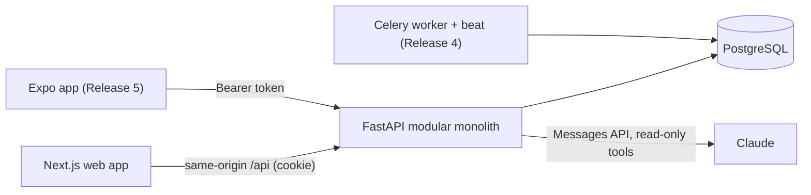
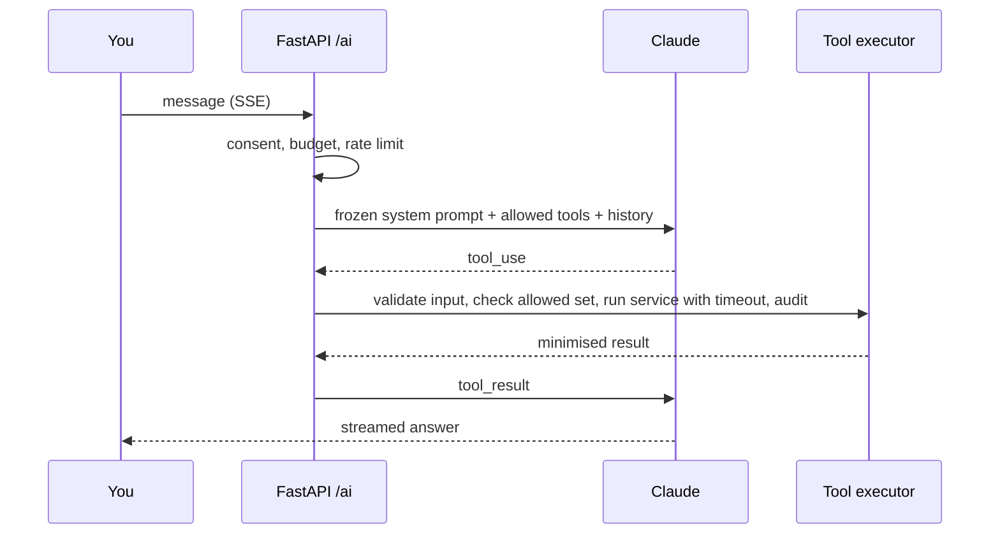

# Architecture overview

Condensed from *Repository Audit & Architecture Blueprint v1.0* (2026-11-17). Decisions are in
[`docs/decisions`](../decisions); milestone status is in [`docs/roadmap.md`](../roadmap.md).

## System

- **One backend for every client.** All business logic lives in FastAPI; Next.js (and later Expo)
  are clients only. The browser calls `/api/*` on the web origin, and Next.js proxies it to FastAPI,
  so the session cookie stays first-party and no CORS is needed.
- **Modular monolith.** `app/modules/<domain>` packages talk to each other only through their
  `service`, `schemas` or `ai_tools` modules. A test enforces this.
- **Deterministic first.** Totals, streaks, goal progress and the dashboard headline are computed
  in SQL or pure functions. The AI explains and plans on top of those numbers.
- **Contracts.** FastAPI's OpenAPI schema generates `packages/api-client`; CI fails if it is stale.

## Data conventions

- UUIDv7 primary keys (time-ordered; clients can generate them offline).
- Every user-owned row has `user_id → users ON DELETE CASCADE`; every query filters on it.
- Instants are `timestamptz` (UTC); human days are `local_date` in the user's time zone.
- Soft delete (`deleted_at`) for user-facing records; `version` for optimistic concurrency.
- Money (from Release 2) as integer minor units plus currency.
- Enumerations as `text` + CHECK constraints; constraint names follow a fixed convention.
- Migrations are autogenerated, then reviewed and edited by hand (extensions, triggers).

## Habits and streaks

Schedules are versioned (a change closes the current version; a Postgres EXCLUDE constraint
prevents overlaps), so past days are always judged by the rules in force then. Breaks
(vacation/sick/rest) are excused: they never break a streak and are excluded from consistency.
Quota habits (N per week/month) count streaks in periods. The engine is pure functions in
`app/modules/habits/streaks.py` with dedicated tests (DST, time-zone changes, schedule changes).

## Life Library and search

`library_items` stores what the user saved: `url` as typed and `url_key` (normalised: scheme,
`www.`, default port, fragment, tracking parameters, parameter order, IDN spelling, YouTube URL
forms) with a partial unique index per user, so a link is saved once. Excerpts (quotes from a
source) and the user's own note live in separate columns and are never merged. A generated
`search_tsv` weights title (A) over excerpt (B) over note (C) with the `simple` configuration;
search combines it with substring matches on title, link and tag names. M5 builds the shared
search service on this column instead of a second index. Link titles are fetched through
`app/core/netguard.py` (see Security).

## AI Chief of Staff

- **Self-hosted loop** on the Messages API (`app/ai/orchestrator.py`); see ADR-0003.
- **Permission levels:** 1 read, 2 suggest, 3 internal write, 4 external write. The registry
  refuses level 3+ tools until the approval workflow exists (Release 6). Restricted actions
  (payments, credentials, deletions, auto-apply) are never registered.
- **Tools** live in each module's `ai_tools.py` and call services, never SQL. Inputs are validated
  with Pydantic; unknown or disallowed tool names are refused and audited (`ai_tool_executions`).
- **Untrusted text** (e.g. a task titled "ignore previous instructions") reaches the model only as
  tool-result data; permissions are decided by the backend, never by model output.
- **History** is stored verbatim, encrypted and append-only; every assistant `tool_use` is
  followed by a stored `tool_result`, so replays stay valid.
- **Cost:** each call is priced in `ai_usage_ledger`; a monthly budget (default $25) is checked
  before each call. Prompt caching: one breakpoint on the static system prompt plus automatic
  caching of the conversation tail; per-day context goes in the user turn.
- **Model:** `claude-opus-5-5`, adaptive thinking, effort `medium`, server-side refusal fallback
  (configurable via `AI_*` settings).

## Security

See [SECURITY.md](../../SECURITY.md). Highlights: opaque hashed sessions, CSRF origin checks,
PKCE + state + nonce for Google, append-only audit log, AES-GCM for AI conversations, log
redaction, second-user tests on every resource.

## Local environment notes

- The repository lives outside iCloud-synced folders; inside `~/Documents` file reads took 2-10 s
  and `git status` hung.
- Development uses a project-local Postgres cluster on port 55432 (`scripts/dev-db.sh`), separate
  from any other Postgres on the machine.
